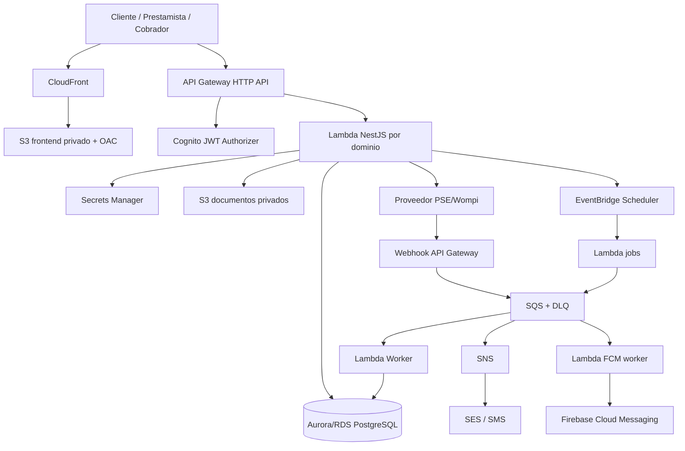
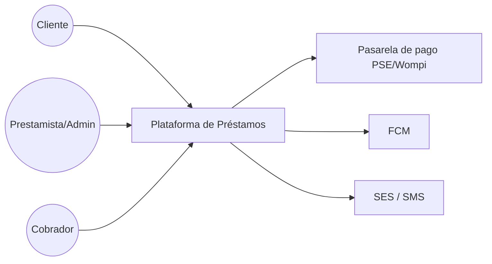
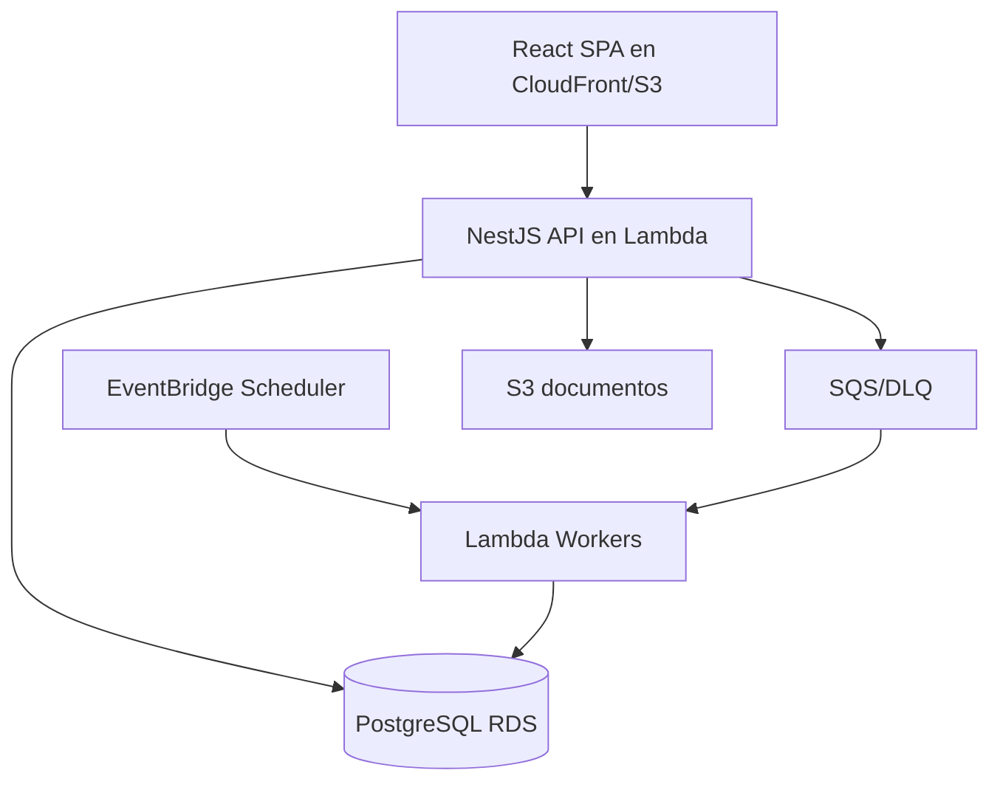
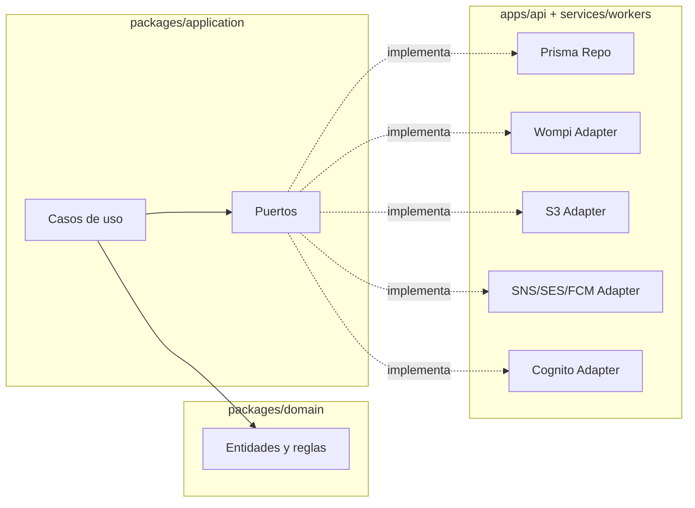
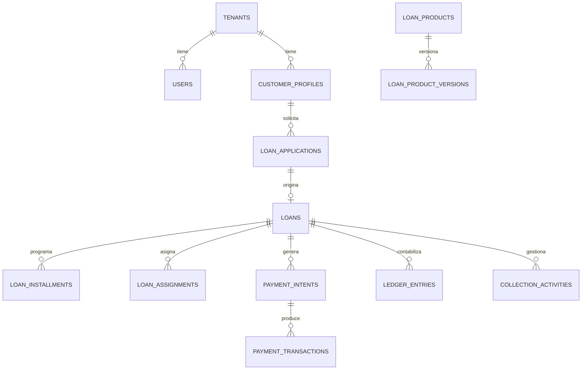
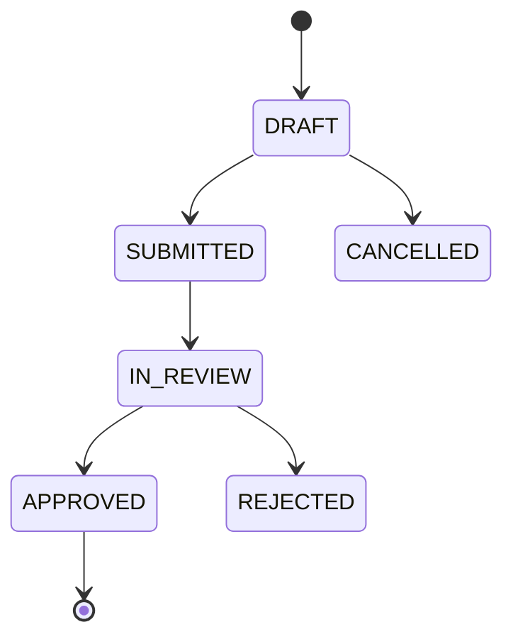
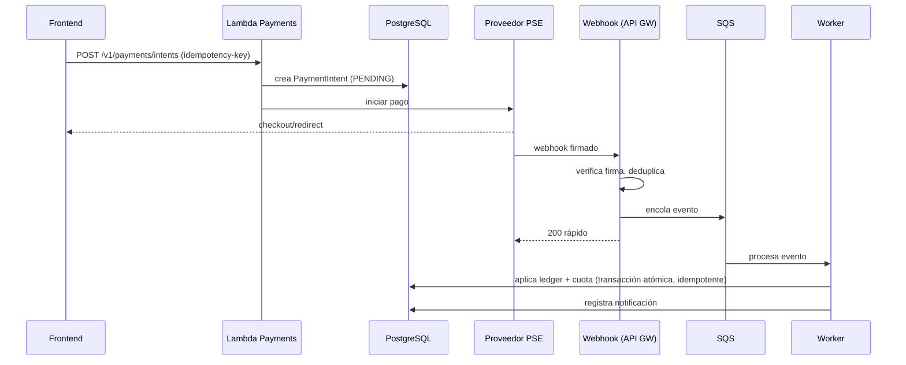

# Design — Plataforma de préstamos y recaudo (AWS)

## Visión general

Diseño técnico de una plataforma serverless multi-tenant para el ciclo de vida de préstamos, construida con React + TypeScript (Vite) en el frontend y NestJS + TypeScript en el backend, PostgreSQL/RDS con Prisma como fuente transaccional, y AWS CDK para infraestructura. El backend NestJS se empaqueta para AWS Lambda detrás de API Gateway HTTP API.

El diseño aplica arquitectura hexagonal/clean: el dominio y los casos de uso no dependen de AWS SDK ni de NestJS; los adaptadores (Prisma, Cognito, S3, SQS, SNS/SES, Wompi, FCM) viven en infraestructura y se conectan mediante puertos (interfaces).

> Este es un artefacto de spec. No implementa código. Las decisiones abiertas de `requirements.md` se resuelven como ADR antes de implementar las áreas afectadas.

### Principios de diseño
- Dinero en COP como enteros; nunca floating point en cálculos financieros.
- UTC en almacenamiento; `America/Bogota` en presentación.
- `tenant_id` obligatorio en toda entidad; aislamiento verificado en backend.
- Operaciones financieras: transaccionales, idempotentes, auditables, inmutables en ledger.
- Pagos confirmados por webhook firmado o consulta server-to-server, nunca por redirección.
- Secretos en Secrets Manager; nada sensible en logs.

---

## Organización del repositorio

Monorepo (pnpm/npm workspaces) con separación de capas:

```text
apps/
  web/                 # React + Vite (admin, cliente, cobrador por rol/layout)
  api/                 # NestJS (controllers + bootstrap Lambda)
services/
  workers/             # Lambdas worker (webhooks, conciliación, jobs, notificaciones)
packages/
  domain/              # entidades y reglas puras, sin framework ni AWS SDK
  application/         # casos de uso y puertos (interfaces)
  contracts/           # DTOs/tipos compartidos no sensibles + cliente OpenAPI
  config/              # convenciones y configuración compartida
infra/
  cdk/                 # AWS CDK (TypeScript)
docs/
  decisions/           # ADRs
  diagrams/            # C4 y flujos
  ux/                  # wireframes
```

### Estructura del backend NestJS

```text
apps/api/src/
  main.ts
  lambda.ts            # adaptador/bootstrap Lambda reutilizando instancia
  app.module.ts
  modules/
    identity/ tenants/ customers/ loan-products/ loan-applications/
    loans/ installments/ payments/ ledger/ collections/ assignments/
    notifications/ reports/ documents/ audit/
  shared/
    auth/ guards/ decorators/ tenant/ validation/
```

Cada módulo separa controllers (entrada HTTP) → casos de uso (`packages/application`) → dominio (`packages/domain`) → adapters. No se colocan cálculos de amortización, reglas de mora ni lógica de ledger en controllers.

### Estructura del frontend React
- Rutas y layouts separados por rol: prestamista (admin), cobrador y cliente.
- Rutas protegidas visualmente, pero la autorización real la aplica el backend.
- Cliente TypeScript generado desde OpenAPI cuando sea viable.
- No se duplican reglas financieras en React: el backend calcula y devuelve cuotas, saldos, mora e indicadores.

---

## Arquitectura AWS

### Componentes principales

| Servicio | Rol |
|---|---|
| CloudFront + S3 (privado + OAC) | Hosting y CDN del frontend React |
| Cognito User Pool | Identidad, grupos/claims, MFA backoffice |
| API Gateway HTTP API | Endpoints `/v1`, JWT authorizer, throttling, CORS restrictivo |
| Lambda (NestJS) | Handlers del API por bounded context |
| Lambda workers | Webhooks, conciliación, jobs, notificaciones |
| RDS/Aurora PostgreSQL | Fuente transaccional (préstamos, ledger, reportes), Multi-AZ en prod |
| SQS + DLQ | Webhooks, notificaciones, conciliación, jobs |
| SNS | Fan-out y SMS según región |
| EventBridge Scheduler | Vencimientos, recordatorios, conciliación |
| SES | Emails transaccionales |
| Secrets Manager / KMS | Credenciales DB, secretos de pago, firma webhook, cifrado |
| WAF | Protección CloudFront/API, reglas administradas, rate limit |
| CloudWatch / X-Ray | Logs, métricas, alarmas, tracing |
| CloudTrail | Auditoría de acciones AWS |
| AWS Backup / Budgets | Respaldos y control de costos |
| VPC | RDS en subnets privadas; Lambda a VPC solo si usa RDS; evaluar RDS Proxy |

### Diagrama lógico



### C4 — Contexto (nivel 1)



### C4 — Contenedores (nivel 2)



---

## Arquitectura hexagonal (puertos y adaptadores)

El dominio define puertos; infraestructura provee adaptadores. Ejemplos de puertos:

- `PaymentProvider` — crear intención, consultar estado, validar webhook (adapter: Wompi; futuros: ePayco, PayU).
- `DocumentStore` — guardar/recuperar documentos y URLs prefirmadas (adapter: S3).
- `NotificationPort` — enviar notificaciones (adapters: SES, SNS/SMS, FCM).
- `EventBus` / `QueuePort` — publicar eventos y encolar trabajos (adapters: EventBridge, SQS).
- `LoanRepository`, `LedgerRepository`, etc. — persistencia (adapter: Prisma/PostgreSQL).
- `IdentityPort` — validación de identidad/claims (adapter: Cognito).



---

## Modelo de datos (relacional)

Entidades principales (todas con `tenant_id` salvo `tenants`):

- `tenants`
- `users` (referencia Cognito `sub`)
- `customer_profiles`
- `consents`
- `loan_products`, `loan_product_versions`
- `loan_applications`, `application_reviews`
- `loans`
- `loan_installments`
- `payment_intents`, `payment_transactions`, `payment_provider_events`, `payment_mandates`
- `ledger_accounts`, `ledger_entries` (inmutable, doble partida)
- `cash_movements`
- `documents`
- `loan_assignments`
- `collection_activities` (o `collection_cases` + `collection_actions`)
- `notifications`
- `audit_logs`
- `idempotency_keys`

### Reglas del modelo
- UUID como identificador público; IDs internos no expuestos.
- Índices por tenant, cliente, estado, fecha de vencimiento y referencia de proveedor.
- Restricciones únicas para referencias externas y claves idempotentes.
- Soft delete solo para datos no financieros; ledger/pagos no se eliminan.
- Migraciones SQL versionadas (Prisma Migrate).

### Modelos sugeridos clave

`loan_assignments`: `id`, `tenant_id`, `loan_id`, `collector_user_id`, `assigned_by_user_id`, `assigned_at`, `ended_at`, `status`, `notes`. Índices por tenant, cobrador, préstamo y estado. Validar que cobrador y préstamo compartan tenant.

`collection_activities`: `id`, `tenant_id`, `loan_id`, `installment_id` (nullable), `collector_user_id`, `channel` (CALL/MESSAGE/VISIT/OTHER), `result`, `notes`, `promise_date` (nullable), `next_action_at` (nullable), `created_at`. No se permite borrar, solo correcciones auditadas.

### Diagrama ER simplificado



---

## Estados y máquinas de estado

- **Cliente:** `PENDING → ACTIVE | REJECTED | BLOCKED`.
- **Solicitud:** `DRAFT → SUBMITTED → IN_REVIEW → APPROVED | REJECTED | CANCELLED`.
- **Préstamo:** `PENDING_DISBURSEMENT → ACTIVE → PAID_OFF | DEFAULTED`; `CANCELLED` desde estados previos.
- **Cuota:** `PENDING → PARTIALLY_PAID → PAID`; `PENDING/PARTIALLY_PAID → OVERDUE`; `WAIVED` solo con permiso y auditoría.
- **Pago:** `CREATED → PENDING → APPROVED | DECLINED | EXPIRED`; `APPROVED → REFUNDED | REVERSED`.
- **Pago manual:** `PENDING_REVIEW → APPROVED (impacta ledger) | REJECTED`.



---

## Flujo de pagos (PSE/Wompi + webhooks)



Puntos clave:
- Idempotency key obligatoria en crear pago y aplicar recaudo.
- Deduplicación por evento/`providerReference`.
- Webhook responde rápido; el procesamiento es asíncrono (SQS → worker).
- DLQ, retry policy y alarmas sobre fallos.
- Conciliación diaria compara proveedor, pagos y ledger; diferencias resueltas con auditoría.
- Manejo de webhook duplicado, retrasado, inválido y fuera de orden.

### Flujo de notificación de aprobación/desembolso

Evento `LoanApproved` → persistir aprobación y condiciones → encolar notificación asíncrona → EventBridge/SNS → SQS → Lambda → FCM (push) y opcional email. Texto: aprobación con desembolso en máximo 72 horas hábiles. Al desembolsar: evento `LoanDisbursed`, notificar medio/fecha/comprobante. No comunicar "dinero enviado" hasta confirmación. Registrar estado/intentos/errores de notificación sin guardar tokens en logs.

> Nota técnica: SNS no envía directamente a FCM; el flujo recomendado es EventBridge/SNS → SQS → Lambda (Firebase Admin SDK con credenciales en Secrets Manager) → FCM.

---

## API `/v1` (borrador)

Prefijo `/v1`. Esquemas exactos se documentan en OpenAPI antes de implementar.

### Cliente
`GET /me`, `PATCH /me/profile`, `POST /loan-applications`, `GET /loan-applications`, `GET /loan-applications/{id}`, `GET /loans`, `GET /loans/{id}`, `GET /loans/{id}/installments`, `GET /payments`, `POST /payments/intents`, `GET /documents/{id}/download`.

### Backoffice
`GET /admin/dashboard`, `GET /admin/customers`, `GET /admin/customers/{id}`, `GET /admin/customers/{id}/payment-history`, `GET /admin/loan-applications`, `POST /admin/loan-applications/{id}/approve`, `POST /admin/loan-applications/{id}/reject`, `POST /admin/loans/{id}/disburse`, `GET /admin/loans`, `GET /admin/loans/{id}`, `POST /admin/loans/{id}/payments/manual`, `POST /admin/loans/{id}/adjustments`, `GET /admin/collections/overdue`, `GET /admin/reports/portfolio`, `GET /admin/reports/cashflow`.

### Cobrador
Endpoints específicos filtrados en backend por `tenant_id` y `collector_user_id`: cartera asignada, cuotas, registro de recaudo, compromisos y gestiones.

### Público / infraestructura
`POST /webhooks/payments/{provider}` (firma obligatoria), `GET /health` (sin datos sensibles).

---

## Seguridad y autorización

- **AuthN:** Cognito JWT authorizer en API Gateway; grupos/claims.
- **AuthZ:** NestJS guards verifican rol, `tenant_id`, ownership y asignación de cartera en cada operación sensible. No se confía en el frontend.
- **Aislamiento multi-tenant:** filtros por `tenant_id` en todos los repositorios; pruebas de acceso cruzado.
- **COLLECTION_AGENT:** acceso restringido a cartera asignada; sin operaciones financieras restringidas (aprobar, desembolsar, tasas, ledger, config).
- **Secretos:** Secrets Manager + KMS; `.env.example` solo con nombres de variables.
- **Datos sensibles:** nunca PAN/CVV; tokenización del proveedor; sin secretos/PII en logs.
- **Red:** RDS en subnets privadas; Lambda a VPC solo si accede a RDS; security groups mínimos; WAF en el borde.
- **IAM:** roles mínimos por Lambda, separación por ambiente, acceso humano vía Identity Center.
- **Auditoría:** `audit_logs` para acciones críticas; CloudTrail para acciones AWS.

---

## Diseño UX/UI

### Identidad visual
- Estilo fintech sobrio y confiable. Paleta: azul profundo (primario), verde (éxito), ámbar (alertas), rojo (mora/errores).
- Tipografía legible, espacios amplios, componentes consistentes (shadcn/ui + Tailwind).
- Responsive: desktop prioritario en backoffice; mobile-first para cliente.
- Estados vacíos, loading, error, confirmación y skeletons.
- Accesibilidad WCAG 2.1 AA; estados con texto e icono, no solo color.

### Navegación por rol

**Admin/prestamista:** Dashboard · Clientes · Solicitudes · Préstamos · Cuotas y recaudos · Cartera vencida/Cobranza · Caja y movimientos · Reportes · Productos y tasas · Usuarios y roles · Configuración/auditoría.

**Cobrador (COLLECTION_AGENT):** Dashboard de mi cartera · Mi cartera · Cuotas · Recaudos · Cobranza · Compromisos · Historial.

**Cliente:** Inicio/resumen · Solicitar préstamo · Mis préstamos · Próximas cuotas · Pagar · Historial de pagos · Documentos · Perfil y consentimientos · Ayuda.

### Pantallas clave
Login/registro/recuperación; dashboard admin con KPI; tabla de clientes; bandeja y evaluación de solicitudes; detalle de préstamo (amortización, documentos, movimientos); calendario de cuotas y cartera vencida; checkout PSE y resultado; portal cliente (próxima cuota, saldo, pagar); historial y comprobantes; configuración de productos/calendario; auditoría y reportes; vistas del cobrador.

### UX de aprobación
Mostrar capital, tasa, periodicidad, número de cuotas, valor, total y cargos. Requerir confirmación explícita antes de aprobar/desembolsar. No permitir cambios silenciosos a condiciones aceptadas; generar nueva versión/consentimiento.

---

## Estrategia de pruebas

- **Dominio y casos de uso:** tests unitarios de amortización, redondeo, calendario de cuotas, mora y reglas de ledger contra ejemplos aprobados.
- **Repositorios y API:** tests de integración (Prisma + PostgreSQL de prueba), incluyendo validación de autorización y aislamiento entre tenants.
- **Pagos:** tests de webhook duplicado, retrasado, inválido y fuera de orden; idempotencia; conciliación.
- **Cobranza:** pruebas de aislamiento de cartera por cobrador.
- **E2E y carga:** flujos críticos de cliente/admin; pruebas de carga previas a producción.
- **Seguridad:** SAST, dependency scan, secret scan, IaC scan.
- **IaC:** `cdk synth`/validación en CI; infraestructura dev reproducible desde cero.

---

## Observabilidad, respaldos y costos
- Logs estructurados, métricas y alarmas en CloudWatch; tracing con X-Ray/ADOT.
- AWS Backup con retención; RDS Multi-AZ + PITR en prod; prueba de restauración.
- AWS Budgets / Cost Anomaly Detection.

## Decisiones de diseño pendientes (ADR)
Las 10 decisiones abiertas de `requirements.md` se documentan en `docs/decisions/ADR-*.md`. Mientras una decisión legal/financiera/pasarela no esté confirmada, se usa interfaz/mock y se bloquea producción hasta resolverla.
