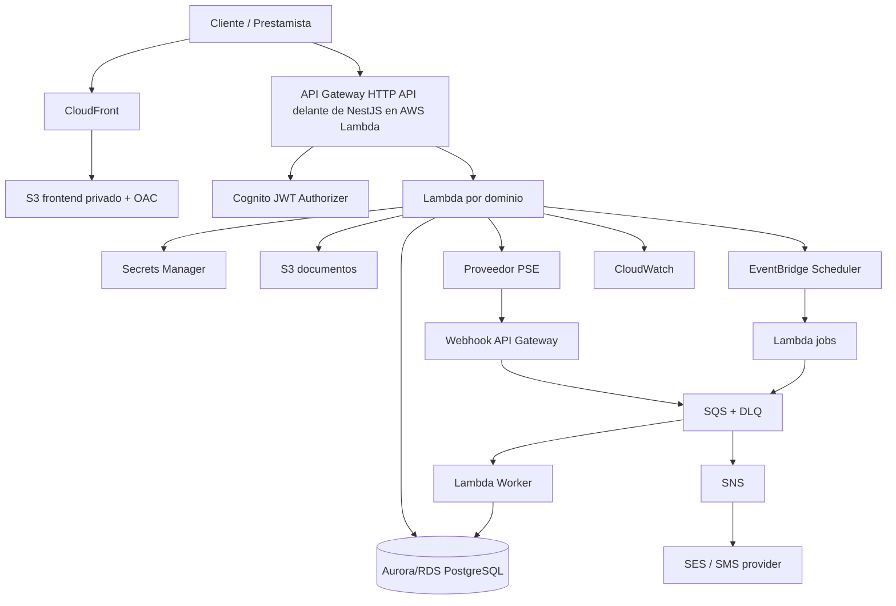

## Stack tecnológico definitivo (React + NestJS)

- **Frontend web:** React + TypeScript, Vite, Tailwind CSS y shadcn/ui. Aplicación responsive para prestamista, cobrador y cliente.
- **Backend:** NestJS + TypeScript, organizado por módulos de dominio y arquitectura hexagonal/Clean Architecture.
- **API:** REST versionada (`/v1`) y documentación OpenAPI/Swagger generada desde NestJS.
- **Persistencia:** PostgreSQL en Amazon RDS; Prisma como ORM, con migraciones versionadas. Las operaciones financieras críticas deben ejecutarse en transacciones SQL.
- **Autenticación:** Amazon Cognito (JWT); guards de NestJS para autenticación, roles y permisos. El backend valida `tenant_id`, asignaciones y propiedad de cada recurso.
- **Despliegue:** NestJS empaquetado para AWS Lambda detrás de API Gateway HTTP API. Mantener un bootstrap/adaptador Lambda compatible con NestJS y reutilizar la instancia cuando el entorno lo permita.
- **Frontend hosting:** S3 privado + CloudFront + Origin Access Control (OAC).
- **Infraestructura:** AWS CDK; ambientes dev/stage/prod separados.
- **Servicios complementarios:** S3 privado para documentos, Wompi mediante adapter de pagos, SQS/DLQ, EventBridge Scheduler, SNS/SES/FCM, Secrets Manager, KMS, CloudWatch, CloudTrail, AWS Backup y AWS Budgets.

### Organización sugerida del repositorio

```text
apps/
  web/                         # React + Vite
  api/                         # NestJS
packages/
  contracts/                   # DTOs/tipos compartidos no sensibles
  config/                       # configuración y convenciones compartidas
infra/
  cdk/                          # AWS CDK
docs/
  architecture/
  adr/
```

### Organización del backend NestJS

```text
apps/api/src/
  main.ts
  app.module.ts
  modules/
    identity/
    tenants/
    customers/
    loan-products/
    loan-applications/
    loans/
    installments/
    payments/
    ledger/
    collections/
    assignments/
    notifications/
    reports/
    documents/
    audit/
  shared/
    auth/
    guards/
    decorators/
    tenant/
    validation/
  domain/                       # entidades/reglas independientes de NestJS
  application/                  # casos de uso y puertos
  adapters/                     # Prisma, AWS, Wompi, FCM, SES
```

Los módulos de negocio deben separar controllers (entrada HTTP), casos de uso, dominio y adapters. No colocar cálculos de amortización, reglas de mora o lógica de ledger directamente en controllers.

### Organización del frontend React

- Separar rutas y layouts por rol: prestamista, cobrador y cliente.
- Proteger rutas visualmente, pero **nunca depender del frontend para autorizar**; NestJS aplica todos los controles.
- Usar componentes reutilizables, formularios validados y estados de carga/error.
- Mantener contratos API tipados y generación de cliente TypeScript desde OpenAPI cuando sea viable.
- No duplicar reglas financieras en React: el backend calcula y devuelve cuotas, saldos, mora e indicadores.

### Criterios de aceptación del stack

- React se compila y publica en S3/CloudFront sin incluir secretos.
- NestJS corre localmente y en Lambda detrás de API Gateway.
- Swagger/OpenAPI documenta los endpoints `/v1`.
- Prisma migrations permiten crear y actualizar el esquema por ambiente.
- Guards de NestJS verifican rol, tenant y asignación de cartera en cada operación sensible.
- Tests unitarios de dominio y casos de uso; tests de integración de repositorios y API.
- CI ejecuta lint, typecheck, tests, build de React, build de NestJS y validación de CDK.
- Ningún despliegue a AWS se ejecuta sin aprobación explícita.


# Spec Kiro — Plataforma de préstamos y recaudo (AWS)

> Documento base para Kiro: especificación funcional, UX/UI, arquitectura, plan e implementación.
> Estado: propuesta inicial (MVP). País de operación previsto: Colombia. Moneda: COP.
> Importante: este documento guía el diseño y desarrollo; antes de operar se requiere revisión legal, financiera y de proveedores de pago.

## 1. Visión y objetivo

Construir una plataforma web responsive para administrar el ciclo de vida de préstamos: registro y validación de clientes, solicitud, evaluación, aprobación, formalización, desembolso, programación de cuotas, recaudo, gestión de mora, cierre y reportes.

La plataforma tendrá dos portales:
- **Backoffice del prestamista/administrador:** administrar clientes, productos, solicitudes, préstamos, cartera, recaudos, liquidez, rentabilidad, mora y configuración.
- **Portal del cliente:** registrarse, completar perfil, solicitar préstamos, consultar obligaciones, descargar documentos, recibir alertas y pagar cuotas.

Diseñar desde el MVP para soportar múltiples prestamistas (multi-tenant), aunque el primer despliegue pueda operar con un único prestamista. No mezclar datos ni movimientos entre tenants.

## 2. Principios y restricciones

- AWS serverless, infraestructura como código y ambientes separados `dev`, `stage` y `prod`.
- Arquitectura modular, hexagonal/clean architecture; lógica de negocio fuera de handlers Lambda.
- API REST versionada (`/v1`), contratos OpenAPI y validación de entrada.
- Dinero representado en COP como enteros (centavos/unidad mínima definida); nunca usar floating point para cálculos financieros.
- Fechas y timestamps almacenados en UTC; presentación en `America/Bogota`.
- Operaciones financieras transaccionales, auditables e idempotentes.
- No almacenar PAN/CVV de tarjetas. Usar tokenización del proveedor certificado.
- No realizar débitos automáticos sin mandato/autorización explícita, verificable y revocable; la tarjeta registrada no equivale a un pagaré ni autoriza por sí sola un débito.
- PSE suele requerir autorización por transacción; débitos recurrentes deben ser soportados por un proveedor/producto contratado y validado.
- No marcar pagos como exitosos por redirección del navegador: confirmar por webhook firmado y/o consulta server-to-server.
- No incluir secretos, tokens, datos de tarjeta ni información personal sensible en logs.
- Las tasas, cargos, mora y cobranza deben configurarse dentro de límites legales vigentes en Colombia y validarse jurídicamente antes de producción.
- No implementar scoring discriminatorio ni decisiones automáticas sin criterios transparentes, auditables y revisables.

## 3. Usuarios, roles y autorización

### Roles
1. `PLATFORM_ADMIN`: administración técnica de tenants y configuración global, acceso restringido.
2. `LENDER_ADMIN`: propietario/administrador de cartera de un tenant.
3. `LENDER_OPERATOR`: operaciones de clientes, solicitudes, cuotas y recaudos con permisos limitados.
4. `COLLECTION_AGENT`: cobrador con acceso únicamente a clientes y préstamos asignados, cuotas, recaudos y actividades de cobranza; sin permisos de aprobación, desembolso ni configuración financiera.
5. `CUSTOMER`: acceso exclusivamente a su perfil, solicitudes, préstamos, cuotas, pagos y documentos.

Aplicar RBAC en backend; no confiar únicamente en ocultar opciones del frontend. Validar `tenantId`, ownership y asignación de cartera en cada operación. Cognito groups/claims pueden ayudar, pero la autorización de negocio debe comprobarse en Lambda.

#### Permisos específicos de `COLLECTION_AGENT`
- Consultar únicamente clientes y préstamos asignados al cobrador dentro de su tenant.
- Consultar cuotas pendientes, próximas, vencidas, saldos e historial de pagos de esa cartera.
- Registrar gestiones: llamadas, mensajes, visitas, resultados, observaciones y próxima acción.
- Registrar compromisos/promesas de pago y consultar su cumplimiento.
- Registrar recaudos en efectivo o transferencia con referencia/soporte y emitir recibo; aplicar el flujo de revisión/autorización configurado para pagos manuales. El registro del cobrador no debe aprobarse automáticamente si requiere revisión.
- Consultar indicadores de su cartera: monto asignado, recaudo del período, cuotas vencidas y compromisos pendientes.
- No aprobar/rechazar solicitudes, definir tasas, modificar condiciones, desembolsar, condonar, ajustar ledger, refinanciar, administrar caja global, usuarios, roles ni configuración.
- No consultar cartera de otros cobradores, salvo permiso explícito de supervisor/administrador y auditoría.
- Toda asignación, reasignación, gestión y recaudo debe quedar auditada.
- Permitir que `LENDER_ADMIN`/roles autorizados asignen y reasignen préstamos o clientes a cobradores; un préstamo puede tener un responsable vigente y conservar historial de asignaciones.

## 4. Alcance funcional del MVP

### 4.1 Autenticación y perfil
- Registro e inicio de sesión con Amazon Cognito (email/OTP o contraseña, MFA configurable para backoffice).
- Recuperación de cuenta, verificación de email/teléfono.
- Perfil de cliente: nombres, identificación, contacto, dirección, ocupación/ingresos y referencias según política.
- Consentimientos versionados: tratamiento de datos, consulta/reporte crediticio si aplica, comunicaciones y mandato de pago.
- KYC básico y revisión manual; no asumir integraciones externas hasta contratarlas.
- Estado del cliente: `PENDING`, `ACTIVE`, `REJECTED`, `BLOCKED`.

### 4.2 Productos y simulador
- Productos configurables: monto mínimo/máximo, plazo, frecuencia (`DAILY`, `BIWEEKLY`, `WEEKLY`, `MONTHLY`, `ANNUAL`), método de amortización, requisitos y reglas de elegibilidad. La tasa de interés no será fija globalmente: el prestamista la define al evaluar/aprobar cada solicitud, dentro de límites legales y reglas de su tenant. Registrar la tasa, unidad/periodicidad, método, fecha y usuario que la definió; mostrar al cliente el costo total antes de aceptar.
- Simulador previo a solicitud que muestra capital, tasa, número de cuotas, cuota estimada, total e intereses, cargos y calendario.
- Versionar condiciones del producto: un préstamo conserva el snapshot aprobado, aunque el producto cambie.
- Validar tasa y cargos con reglas regulatorias vigentes.

### 4.3 Solicitud, evaluación y aprobación
- Cliente crea solicitud con monto, plazo, frecuencia y propósito opcional.
- Backoffice consulta expediente, historial interno y capacidad de pago.
- Estados: `DRAFT`, `SUBMITTED`, `IN_REVIEW`, `APPROVED`, `REJECTED`, `CANCELLED`.
- Registrar decisión, usuario, fecha, motivo y condiciones.
- No desembolsar automáticamente al aprobar: requiere acción autorizada y confirmación.

### 4.4 Formalización y desembolso
- Generar contrato y pagaré desde plantillas versionadas (revisión legal).
- Firma electrónica mediante proveedor integrado; guardar evidencia, versión, timestamps y hash del documento.
- Registrar mandato de débito recurrente separado del pagaré.
- Desembolso por transferencia/proceso externo inicialmente registrable manualmente; integrar proveedor en fase posterior.
- Estados del préstamo: `PENDING_DISBURSEMENT`, `ACTIVE`, `PAID_OFF`, `CANCELLED`, `DEFAULTED` (default no significa borrar deuda).
- Al desembolsar, crear calendario de amortización y movimientos contables de forma atómica.

### 4.5 Préstamo, cuotas y amortización
- Frecuencias: diaria, quincenal, semanal, mensual y anual.
- Definir regla explícita de calendario por préstamo: diaria +1 día; quincenal +15 días (propuesta inicial, configurable); semanal +7 días; mensual mismo día o último día válido del mes; anual misma fecha o último día válido. Confirmar si quincenal debe ser cada 15 días o días 15 y fin de mes. No confundir frecuencia de cuotas con plazo total del crédito.
- Métodos iniciales: cuota fija (francés) y capital fijo (alemán), seleccionables por producto. Validar fórmulas y redondeo.
- Cada cuota: número, fecha de vencimiento, capital, interés, cargos autorizados, total, saldo, estado y días de mora.
- Estados: `PENDING`, `PARTIALLY_PAID`, `PAID`, `OVERDUE`, `WAIVED` (solo con permiso y auditoría).
- Permitir pago parcial y abono extraordinario únicamente con reglas claras de aplicación (interés/capital y recalcular o reducir plazo/cuota).
- Recalcular saldo desde movimientos/ledger; no modificar pagos históricos.

### 4.6 Pagos y recaudo
- Integración de pagos mediante interfaz `PaymentProvider`. **Propuesta inicial: Wompi para checkout con PSE y tarjetas**, sujeto a aprobación comercial, onboarding, tarifas, sandbox y validación de capacidades del contrato. PSE será pago iniciado/autorizado por el cliente; no asumir débitos recurrentes. Mantener el proveedor desacoplado para poder integrar ePayco, PayU u otro en el futuro. No asumir disponibilidad de pagos recurrentes del proveedor.
- Crear intención de pago por cuota(s), registrar `providerReference`, importe, estado, canal y timestamps.
- Estados: `CREATED`, `PENDING`, `APPROVED`, `DECLINED`, `EXPIRED`, `REFUNDED`, `REVERSED`.
- Webhook: verificar firma/autenticidad, tolerar reintentos, deduplicar por evento/provider reference, responder rápido y procesar asíncronamente.
- SQS para procesamiento de webhook y conciliación; DLQ, retry policy y alarmas.
- Idempotency key obligatoria en crear pago y aplicar recaudo.
- Conciliación diaria de pagos contra proveedor y ledger; detectar diferencias y permitir resolución auditada.
- Registrar pagos manuales por **transferencia bancaria o efectivo**, seleccionados por el operador/prestamista. En efectivo, generar recibo y registrar caja/usuario; en transferencia, registrar referencia y soporte. El pago manual debe quedar `PENDING_REVIEW` hasta validación cuando corresponda; solo después impacta el ledger. Registrar comprobante, operador, motivo y aprobación si supera umbral.
- Débito recurrente: fase posterior; tokenización del proveedor y mandato explícito, revocable y con evidencia. Nunca guardar datos sensibles de tarjeta.

### 4.7 Mora y cobranza
- Asignación de cartera: permitir asignar préstamos/clientes a cobradores por tenant, con responsable vigente, fechas de inicio/fin, usuario que asigna y motivo opcional. Mantener historial; no sobrescribir asignaciones anteriores.
- Modelo sugerido `loan_assignments`: `id`, `tenant_id`, `loan_id`, `collector_user_id`, `assigned_by_user_id`, `assigned_at`, `ended_at`, `status`, `notes`. Índices por tenant, cobrador, préstamo y estado. Validar que el cobrador y préstamo pertenezcan al mismo tenant.
- Modelo sugerido `collection_activities`: `id`, `tenant_id`, `loan_id`, `installment_id` nullable, `collector_user_id`, `channel` (CALL, MESSAGE, VISIT, OTHER), `result`, `notes`, `promise_date` nullable, `next_action_at` nullable, `created_at`. Registrar autor y timestamp; no permitir borrar actividades, solo correcciones auditadas.
- La cartera del cobrador se obtiene desde asignaciones vigentes; los endpoints deben filtrar en backend por `tenant_id` y `collector_user_id`.
- Job diario que identifica cuotas vencidas, actualiza métricas y genera eventos.- Job diario que identifica cuotas vencidas, actualiza métricas y genera eventos.
- Reglas configurables de recordatorio: antes del vencimiento, día de vencimiento y después del vencimiento. **Regla inicial de mora:** una cuota se considera vencida desde el día siguiente a su fecha de vencimiento si no está pagada completamente; la mora se calcula por cuota vencida. No aplicar automáticamente intereses/cargos de mora hasta definir y validar su legalidad y fórmula.
- Notificaciones por SNS (email/SMS según configuración y disponibilidad regional); push/web notifications opcionales.
- Historial de gestiones de cobranza: fecha, canal, agente, resultado y próxima acción.
- Cargos de mora solo si están legalmente permitidos, configurados y explicados al cliente.
- No habilitar prácticas de cobranza abusivas; respetar horarios, consentimientos y normativa.

### 4.8 Dashboard del prestamista
Mostrar, con filtros por período y tenant:
- Capital disponible para prestar (liquidez operativa menos reservas/compromisos).
- Capital colocado/desembolsado pendiente de recuperación.
- Capital recuperado.
- Intereses efectivamente recaudados (ganancia realizada).
- Intereses proyectados/por cobrar (no tratarlos como ganancia realizada).
- Total cartera por cobrar y cartera vencida.
- Recaudo del día/semana/mes.
- Número de préstamos activos, liquidados y en mora.
- Clientes puntuales, con retrasos y morosos.
- Flujo de caja y movimientos.
- Gráficas de recaudo, vencimientos y mora.

Separar siempre capital, intereses, cargos, gastos, provisiones/pérdidas y liquidez. El dashboard no debe sumar capital recuperado como utilidad.

### 4.9 Historial y perfil de riesgo interno
- Historial de préstamos y cuotas por cliente.
- Métricas: puntualidad (%), retraso promedio, cuotas vencidas, refinanciaciones y créditos liquidados.
- Score interno explicable, basado en reglas configurables; no usarlo como decisión única.
- Etiquetas informativas (puntual, retraso ocasional, mora frecuente), no discriminatorias y corregibles.
- Permitir corregir datos inexactos y registrar auditoría.
- No consultar centrales de riesgo sin autorización y contrato aplicable.

### 4.10 Documentos, notificaciones y reportes
- S3 privado para contratos, pagarés, soportes y comprobantes; URLs prefirmadas de corta duración.
- Versionado, cifrado y políticas de retención.
- Plantillas PDF para contrato, pagaré, estado de cuenta y paz y salvo.
- SNS para notificaciones; email/SMS con proveedor compatible; SQS para trabajos asíncronos.
- Exportación CSV/XLSX/PDF de cartera, recaudo, vencimientos y movimientos.
- Auditoría de acciones críticas: aprobación, desembolso, cambio de tasa, ajustes, pago manual, refinanciación y cierre.

## 5. Fuera del MVP
- Marketplace público de prestamistas.
- Captación/inversión de terceros y reparto de rendimientos.
- Open banking, consulta automática de centrales de riesgo y KYC avanzado.
- Débitos automáticos con tarjeta/cuenta hasta validar proveedor, mandato y marco legal.
- IA para aprobación automática.
- App nativa iOS/Android (MVP web responsive/PWA).
- Contabilidad fiscal completa; el MVP tendrá ledger operativo y reportes.

## 6. Arquitectura AWS propuesta

### Servicios
- **Amazon CloudFront:** CDN y distribución del frontend; HTTPS, cache policies y protección básica.
- **Amazon S3:** hosting frontend (bucket privado + CloudFront OAC), documentos privados y artefactos.
- **Amazon Cognito:** User Pool para identidad; grupos/claims; MFA backoffice.
- **Amazon API Gateway (HTTP API):** REST endpoints `/v1`; JWT authorizer Cognito, throttling y CORS restrictivo. REST API si se necesita WAF/API features específicas.
- **AWS Lambda:** handlers del API y workers; NestJS/TypeScript (runtime Node.js) LTS; funciones pequeñas por bounded context, no una Lambda gigante.
- **Amazon DynamoDB:** alternativa para datos operativos de alto volumen/eventos; **recomendación inicial: PostgreSQL en Amazon RDS/Aurora Serverless v2** para préstamos, ledger y reportes relacionales/transaccionales. DynamoDB no es requisito para todo; usarlo solo cuando el patrón lo justifique.
- **Amazon RDS PostgreSQL / Aurora PostgreSQL:** fuente transaccional principal, Multi-AZ en producción, backups/PITR, cifrado.
- **Amazon SQS + DLQ:** colas de webhooks, notificaciones, conciliación y jobs; consumidores Lambda.
- **Amazon SNS:** fan-out y notificaciones email/SMS (validar capacidades/región); eventos internos pueden usar EventBridge.
- **Amazon EventBridge Scheduler:** vencimientos, recordatorios, conciliación y jobs periódicos.
- **AWS Secrets Manager:** credenciales DB, secretos de proveedor de pago y firma webhook.
- **AWS KMS:** cifrado de datos y documentos/secretos.
- **AWS WAF:** proteger CloudFront/API contra tráfico malicioso, reglas administradas y rate limits.
- **Amazon CloudWatch:** logs estructurados, métricas, dashboards, alarmas y tracing.
- **AWS X-Ray / ADOT:** trazabilidad distribuida cuando aplique.
- **AWS CloudTrail:** auditoría de acciones AWS.
- **AWS IAM:** roles mínimos por Lambda, separación por ambiente y acceso humano con Identity Center.
- **AWS CDK (TypeScript) o SAM:** infraestructura como código; elegir CDK como estándar salvo decisión contraria.
- **AWS CodeBuild/CodePipeline o GitHub Actions OIDC:** CI/CD con lint, tests, build, scan y despliegue por ambiente con aprobación prod.
- **Amazon SES:** emails transaccionales (dominio verificado).
- **AWS Backup:** backups centralizados y políticas de retención.
- **AWS Budgets/Cost Anomaly Detection:** control de costos.
- **VPC:** RDS en subnets privadas; Lambda conectada a VPC solo cuando necesita RDS; security groups mínimos. Evaluar RDS Proxy para concurrencia Lambda.
- **Amazon Bedrock:** no requerido en MVP; no usar IA para decisiones crediticias sin gobernanza.

### Flujo de pagos
1. Frontend solicita crear pago → API Gateway → Lambda Payments.
2. Lambda crea `PaymentIntent` pendiente e invoca proveedor PSE.
3. Cliente completa pago en checkout/redirect del proveedor.
4. Proveedor envía webhook → API Gateway endpoint público protegido por firma.
5. Lambda valida firma, guarda evento y encola en SQS.
6. Worker valida/deduplica y aplica movimiento al ledger + cuota en transacción.
7. SNS/SES notifica resultado.
8. Job de conciliación compara proveedor, pagos y ledger.

### Diagrama lógico


## 7. Diseño UX/UI

### Identidad visual
- Estilo fintech profesional, confiable y sobrio.
- Paleta sugerida: azul profundo como primario, verde para estados exitosos, ámbar para alertas y rojo para mora/errores.
- Tipografía legible, espacios amplios, componentes consistentes y accesibilidad WCAG 2.1 AA.
- Responsive: desktop prioritario para backoffice; mobile-first para cliente.
- Estados vacíos, loading, error, confirmación y skeletons.
- No depender solo del color para estados; incluir texto e icono.

### Navegación del administrador
- Dashboard
- Clientes
- Solicitudes
- Préstamos
- Cuotas y recaudos
- Cartera vencida / Cobranza
- Caja y movimientos
- Reportes
- Productos y tasas
- Usuarios y roles
- Configuración / auditoría

### Navegación del cobrador (`COLLECTION_AGENT`)
- Dashboard de mi cartera: asignado, recaudo del día/período, mora y compromisos.
- Mi cartera: clientes y préstamos asignados, con búsqueda y filtros.
- Cuotas: próximas, pendientes, vencidas y detalle de saldo.
- Recaudos: registrar efectivo/transferencia, adjuntar soporte y consultar estado/recibo.
- Cobranza: registrar llamadas, mensajes y visitas; resultado y próxima acción.
- Compromisos: promesas de pago, fechas y cumplimiento.
- Historial: pagos y gestiones realizadas por la cartera asignada.

### Navegación del cliente
- Inicio / resumen
- Solicitar préstamo
- Mis préstamos
- Próximas cuotas
- Pagar
- Historial de pagos
- Documentos
- Perfil y consentimientos
- Ayuda / contacto

### Pantallas clave
1. Login / registro / recuperación.
2. Dashboard administrador con KPI y gráficos.
3. Tabla de clientes con búsqueda, filtros y detalle.
4. Bandeja de solicitudes y pantalla de evaluación.
5. Detalle del préstamo: resumen, amortización, documentos y movimientos.
6. Calendario de cuotas y cartera vencida.
7. Checkout PSE y resultado de pago.
8. Portal cliente: próxima cuota, saldo, botón pagar y estado.
9. Historial de pagos y comprobantes.
10. Configuración de productos y calendario.
11. Auditoría y reportes.
12. Cobrador: dashboard, cartera asignada, detalle de cliente/préstamo, cuotas, registro de recaudo, compromisos y bitácora de gestiones.

### UX de aprobación
- Mostrar capital, tasa, periodicidad, número de cuotas, valor, total a pagar y cargos.
- Requerir confirmación explícita antes de aprobar/desembolsar.
- No permitir cambios silenciosos a condiciones aceptadas; generar nueva versión/consentimiento.

## 8. Modelo de datos inicial (relacional)

Entidades principales:
- `tenants`
- `users` (referencia Cognito `sub`)
- `customer_profiles`
- `consents`
- `loan_products` + `loan_product_versions`
- `loan_applications`
- `application_reviews`
- `loans`
- `loan_installments`
- `payment_intents`
- `payment_transactions`
- `payment_provider_events`
- `payment_mandates`
- `ledger_accounts`
- `ledger_entries` (inmutable, doble partida recomendado)
- `cash_movements`
- `documents`
- `collection_cases`
- `collection_actions`
- `notifications`
- `audit_logs`
- `idempotency_keys`

Reglas:
- Todas las entidades de negocio con `tenant_id`.
- UUID como identificador público; IDs internos no exponer.
- Índices por tenant, cliente, estado, fecha de vencimiento y referencia del proveedor.
- Restricciones únicas para referencias externas y claves idempotentes.
- Soft delete solo para datos no financieros; ledger/pagos no se eliminan.
- Migraciones SQL versionadas.

## 9. API inicial (borrador)

Prefijo `/v1`.

### Cliente
- `GET /me`
- `PATCH /me/profile`
- `POST /loan-applications`
- `GET /loan-applications`
- `GET /loan-applications/{id}`
- `GET /loans`
- `GET /loans/{id}`
- `GET /loans/{id}/installments`
- `GET /payments`
- `POST /payments/intents`
- `GET /documents/{id}/download`

### Backoffice
- `GET /admin/dashboard`
- `GET /admin/customers`
- `GET /admin/customers/{id}`
- `GET /admin/customers/{id}/payment-history`
- `GET /admin/loan-applications`
- `POST /admin/loan-applications/{id}/approve`
- `POST /admin/loan-applications/{id}/reject`
- `POST /admin/loans/{id}/disburse`
- `GET /admin/loans`
- `GET /admin/loans/{id}`
- `POST /admin/loans/{id}/payments/manual`
- `POST /admin/loans/{id}/adjustments`
- `GET /admin/collections/overdue`
- `GET /admin/reports/portfolio`
- `GET /admin/reports/cashflow`
- `POST /webhooks/payments/{provider}` (público, firma obligatoria)
- `GET /health` (sin datos sensibles)

Los endpoints exactos y schemas deben quedar documentados en OpenAPI antes de implementar.

## 10. Plan de implementación para Kiro

Kiro debe trabajar por fases, crear primero artefactos de spec y no implementar todo en una sola pasada.

### Fase 0 — Discovery y decisiones
- Confirmar single-lender vs multi-tenant; se diseña multi-tenant por defecto.
- Definir tasa, amortización, reglas de calendario, abonos, pagos parciales y mora.
- Seleccionar proveedor PSE y validar contrato/mandatos.
- Validar marco legal colombiano y requerimientos de firma/documentos.
- Definir presupuesto AWS, región, RPO/RTO y volumen.
**Salida:** `docs/decisions/ADR-*.md`, glosario, reglas financieras aprobadas.

### Fase 1 — Spec y diseño
- Crear `requirements.md` con historias de usuario y criterios de aceptación verificables.
- Crear `design.md` con arquitectura, componentes, secuencias, modelo de datos y seguridad.
- Crear `tasks.md` con tareas pequeñas, ordenadas y testeables.
- Crear OpenAPI `/v1`.
- Crear diagramas C4 (contexto, contenedores, componentes) y flujo de pago.
- Wireframes de administrador y cliente.
**Gate:** revisión del propietario antes de código.

### Fase 2 — Fundación
- Monorepo sugerido:
```text
apps/
  admin-web/
  customer-web/
services/
  api/
  workers/
packages/
  domain/
  application/
  contracts/
  shared/
infra/
  cdk/
docs/
  decisions/
  diagrams/
  ux/
```
- Configurar lint/format, TypeScript strict, tests, commits convencionales.
- CDK: VPC, RDS, Cognito, S3/CloudFront, API Gateway, Lambda, SQS/DLQ, SNS, EventBridge, Secrets, KMS, WAF, CloudWatch.
- Ambientes y pipelines con approvals.
**Gate:** infraestructura dev reproducible y smoke tests.

### Fase 3 — Identidad y clientes
- Cognito, RBAC, tenant isolation.
- Registro, login, perfil, consentimientos, documentos.
- Backoffice CRUD y búsqueda de clientes.
- Pruebas de autorización y acceso cruzado entre tenants.
**Gate:** seguridad y pruebas de permisos.

### Fase 4 — Productos, solicitudes y aprobación
- Productos/versiones y simulador.
- Solicitudes, evaluación, aprobación/rechazo.
- Auditoría de decisiones.
- UI bandeja y detalle.
**Gate:** criterios financieros y UX validados.

### Fase 5 — Préstamos y ledger
- Formalización, desembolso, amortización.
- Cuotas y estados.
- Ledger de doble partida e invariantes.
- Abonos, pagos parciales y liquidación.
- Pruebas de fórmulas, redondeos y casos límite.
**Gate:** conciliación de saldo y amortización contra ejemplos aprobados.

### Fase 6 — Pagos PSE y recaudo manual
- Adaptador Wompi sandbox (PSE y métodos habilitados en contrato); interfaz intercambiable para futuros proveedores.
- Registrar recaudos por transferencia y efectivo con evidencia y validación.
- Intents, checkout, webhooks, firma, idempotencia.
- SQS worker, DLQ, reintentos, conciliación.
- UI pagar y comprobante.
- Pruebas de webhook duplicado, retrasado, inválido y fuera de orden.
**Gate:** sandbox certificado y conciliación correcta.

### Fase 7 — Cobranza, dashboard y reportes
- Jobs de vencimiento con EventBridge.
- SNS, SES y Firebase Admin/FCM con templates.
- Casos y acciones de cobranza; asignación/reasignación de cartera y bitácora de gestiones.
- Vistas y endpoints específicos para `COLLECTION_AGENT`, con filtros de asignación aplicados en backend y pruebas de aislamiento.
- KPIs, filtros, exportación.
- Score interno explicable.
**Gate:** métricas conciliadas contra ledger.

### Fase 8 — Seguridad, calidad y producción
- Threat modeling y revisión de permisos IAM.
- SAST, dependency scan, secret scan y IaC scan.
- Pruebas unitarias, integración, E2E y carga.
- WAF, alarmas, dashboards, runbooks y backups restore test.
- Revisión legal, privacidad y proveedor de pagos.
- Deploy gradual y rollback.
**Gate:** checklist de go-live aprobado.

## 11. Criterios de aceptación globales

- Un cliente no puede acceder a información de otro cliente ni tenant.
- Un operador/cobrador no puede aprobar/desembolsar si carece de permiso.
- Un cobrador solo consulta y gestiona cartera asignada dentro de su tenant; no puede acceder a cartera de otro cobrador ni ejecutar operaciones financieras restringidas.
- Asignaciones, reasignaciones y gestiones de cobranza quedan auditadas y conservan historial.
- Toda aprobación, desembolso, ajuste y recaudo queda auditado.
- Una misma notificación de pago procesada varias veces produce un único movimiento financiero.
- Un pago aprobado solo por webhook autenticado/consulta server-to-server se aplica al ledger.
- La suma de movimientos y saldos coincide; el ledger no se modifica ni elimina.
- Cuotas semanal, quincenal y mensual generan fechas consistentes y explicables.
- El dashboard separa capital, interés, recaudo y liquidez.
- Las ganancias realizadas no incluyen intereses aún no cobrados ni capital recuperado.
- Documentos y archivos privados no son accesibles sin autorización.
- No se almacenan PAN/CVV.
- Todas las funciones críticas tienen pruebas y alarmas.
- Infraestructura puede desplegarse desde cero por IaC en ambiente no productivo.
- Producción requiere aprobación manual.

## 12. Instrucciones para Kiro

1. Leer este documento completo.
2. No comenzar generando toda la aplicación; primero producir `requirements.md`, `design.md` y `tasks.md`.
3. Identificar contradicciones, riesgos y decisiones faltantes; documentarlas como preguntas/ADR, no asumir silenciosamente.
4. Usar AWS CDK para IaC y TypeScript para infraestructura; backend Lambda en NestJS/TypeScript, salvo decisión explícita.
5. Aplicar arquitectura hexagonal: dominio sin AWS SDK ni framework; adaptadores AWS en infraestructura.
6. Generar contratos OpenAPI y schemas compartidos antes de conectar frontend.
7. Implementar por vertical slices, con pruebas y gates por fase.
8. No desplegar ni modificar recursos reales de AWS sin aprobación explícita.
9. No usar credenciales reales; `.env.example` con nombres de variables y Secrets Manager en AWS.
10. Mantener README, ADRs, diagramas, checklist de seguridad y decisiones actualizados.
11. Para cada tarea: explicar alcance, archivos afectados, pruebas y riesgos; ejecutar tests y reportar resultado.
12. Si una decisión legal/financiera/pasarela no está confirmada, usar interfaz/mock y bloquear producción hasta resolverla.

## 13. Prompt inicial para Kiro

```text
Actúa como Staff Software Architect, Product Designer y Tech Lead especializado en fintech serverless AWS.

Usa el documento SPEC.md como fuente principal. Primero analiza el alcance y crea:
- requirements.md con requisitos funcionales/no funcionales, user stories y acceptance criteria.
- design.md con arquitectura AWS, arquitectura hexagonal, diagramas Mermaid, modelo relacional, seguridad, flujos PSE/webhooks y UX.
- tasks.md con tareas incrementales, dependencias, esfuerzo relativo, Definition of Done y gates.

No implementes todavía. Señala decisiones abiertas, riesgos regulatorios y contradicciones. Prioriza un MVP seguro y verificable. Diseña multi-tenant para varios prestamistas independientes y contempla el rol COLLECTION_AGENT con cartera asignada, permisos restringidos, bitácora de llamadas/visitas/promesas y menú propio. Incluye loan_assignments y collection_activities, controles de tenant/ownership y pruebas de aislamiento. La tasa la define el prestamista por solicitud; frecuencias: diaria, quincenal, semanal, mensual y anual; recaudo online con Wompi/PSE sujeto a validación; desembolso por transferencia o efectivo; push de aprobación con plazo máximo de 72 horas hábiles; mora desde el día siguiente al vencimiento de cuota. No inventes fórmulas financieras ni reglas legales no definidas. Después de mi aprobación, implementa fase por fase, con tests, documentación y revisión de seguridad. No despliegues a AWS sin autorización explícita.
```

## 14. Decisiones acordadas y pendientes

### Decisiones confirmadas por el propietario
1. **Modelo:** varios prestamistas independientes (multi-tenant). Cada prestamista administra su capital, clientes, tasas, préstamos, recaudos, ganancias y cartera.
2. **Tasa:** la define el prestamista al evaluar/aprobar cada solicitud de crédito. Debe quedar registrada y visible para el cliente antes de aceptar; validar límites legales vigentes.
3. **Frecuencias:** diaria, quincenal, semanal, mensual y anual. Propuesta por defecto para quincenal: cada 15 días, pendiente confirmar si se prefieren fechas 15/fin de mes.
4. **Pagos online:** evaluar Wompi como primera integración para PSE y tarjetas, sujeto a onboarding, contrato, sandbox y verificación de capacidades. PSE no equivale a débito automático.
5. **Desembolso:** transferencia bancaria o efectivo, seleccionados por el administrador. Registrar medio, responsable, fecha, referencia/recibo y evidencia; notificar al cliente.
6. **Notificación de aprobación:** enviar push al cliente indicando que el crédito fue aprobado y que el desembolso se realizará en un plazo máximo de **72 horas hábiles**. El mensaje debe aclarar que el plazo corresponde a días hábiles y que el desembolso puede ser transferencia o efectivo según lo seleccionado.
7. **Mora:** cuota impaga después de su fecha límite se marca vencida; regla propuesta: desde el día siguiente al vencimiento. No calcular sanciones/intereses de mora hasta que se defina fórmula y se valide legalmente.

### Pendientes por confirmar
- Método de amortización: francés (cuota fija), alemán (capital fijo) u otro; permitir configuración por producto.
- Quincenal: cada 15 días o fechas 15 y fin de mes.
- Firma electrónica y pagaré: proveedor y si estará en MVP.
- Pagos parciales/abonos anticipados: habilitación y orden de aplicación a capital/interés.
- Refinanciación: reglas, aprobación y recálculo.
- Reintentos de cobro automático: solo si el proveedor soporta el mandato; requiere autorización del cliente.
- Volumen inicial y crecimiento esperado.
- Presupuesto mensual AWS, región definitiva, RPO/RTO.
- Proveedor de SMS y términos de uso de FCM/SES.

### Notificación de aprobación y desembolso (requisito)
Evento `LoanApproved`:
- Persistir aprobación y condiciones.
- Encolar notificación de forma asíncrona.
- Enviar push por FCM al dispositivo del cliente (y opcional email).
- Texto sugerido: “Tu crédito fue aprobado. El desembolso se realizará en un plazo máximo de 72 horas hábiles. Recibirás una notificación cuando se complete.”
- Al ejecutar desembolso, emitir `LoanDisbursed` y notificar medio (transferencia/efectivo), fecha y comprobante.
- No comunicar “dinero enviado” hasta que el desembolso esté confirmado y registrado.
- Registrar estado de notificación, intentos y errores sin guardar tokens en logs.

### Requisito técnico de notificaciones
- Firebase Cloud Messaging (FCM) será el canal de push móvil/web si se desarrolla app/PWA compatible.
- Lambda worker con Firebase Admin SDK y credenciales en Secrets Manager.
- SNS se utiliza para fan-out/eventos y SMS cuando aplique; **SNS no envía directamente una notificación genérica a FCM**, por lo que el flujo recomendado es EventBridge/SNS → SQS → Lambda → FCM.

## 15. Definition of Ready / Done

Una tarea está lista cuando tiene contexto, reglas, contrato, criterios de aceptación, dependencias y diseño aprobado.

Una tarea está terminada cuando:
- código y pruebas pasan;
- validación de entrada y autorización están implementadas;
- logs no contienen datos sensibles;
- métricas/errores son observables;
- documentación y OpenAPI están actualizados;
- revisión de código y seguridad completadas;
- no hay despliegue productivo implícito.


## Instrucción actualizada para Kiro

Usar React + TypeScript + Vite en `apps/web` y NestJS + TypeScript en `apps/api`; PostgreSQL/RDS con Prisma; AWS CDK para infraestructura; NestJS desplegado en Lambda detrás de API Gateway. Antes de implementar, generar `requirements.md`, `design.md` y `tasks.md`, actualizar OpenAPI y registrar decisiones en ADR. No sustituir este stack por Next.js, Express puro, DynamoDB como base transaccional principal ni otro framework sin aprobación explícita.
